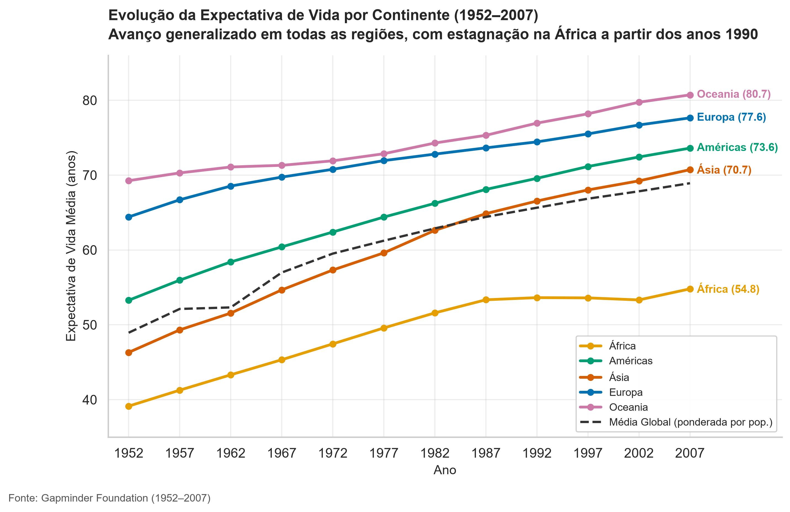
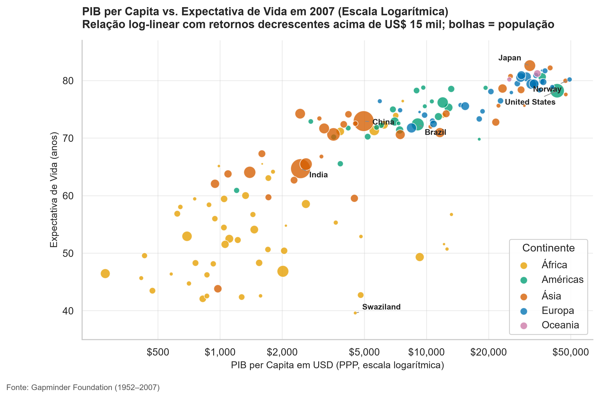
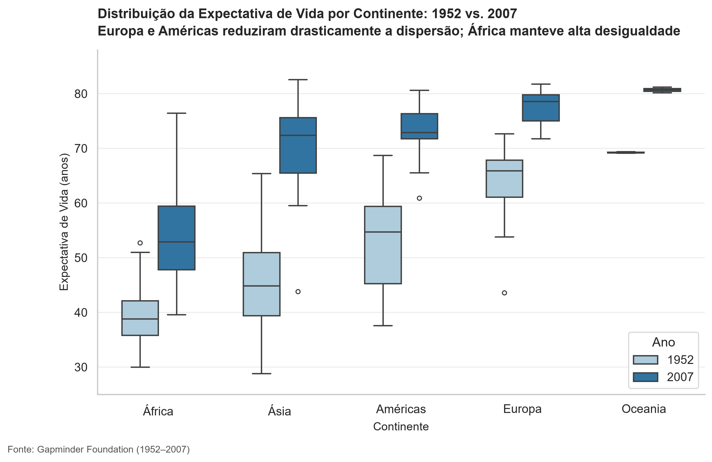
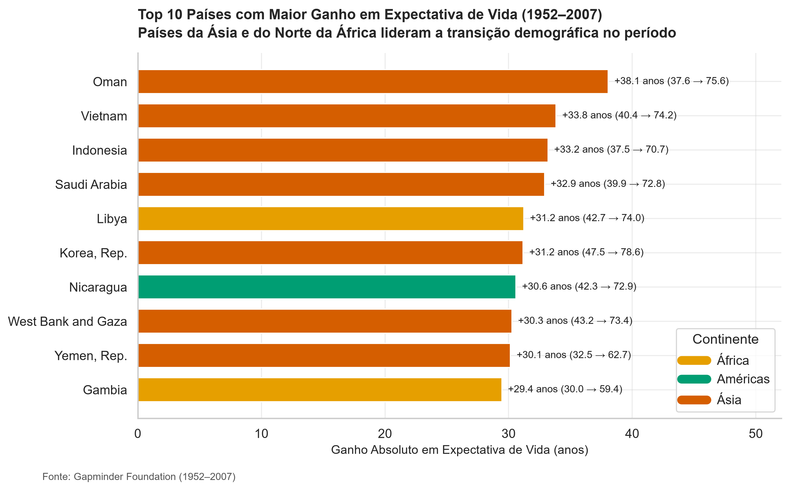
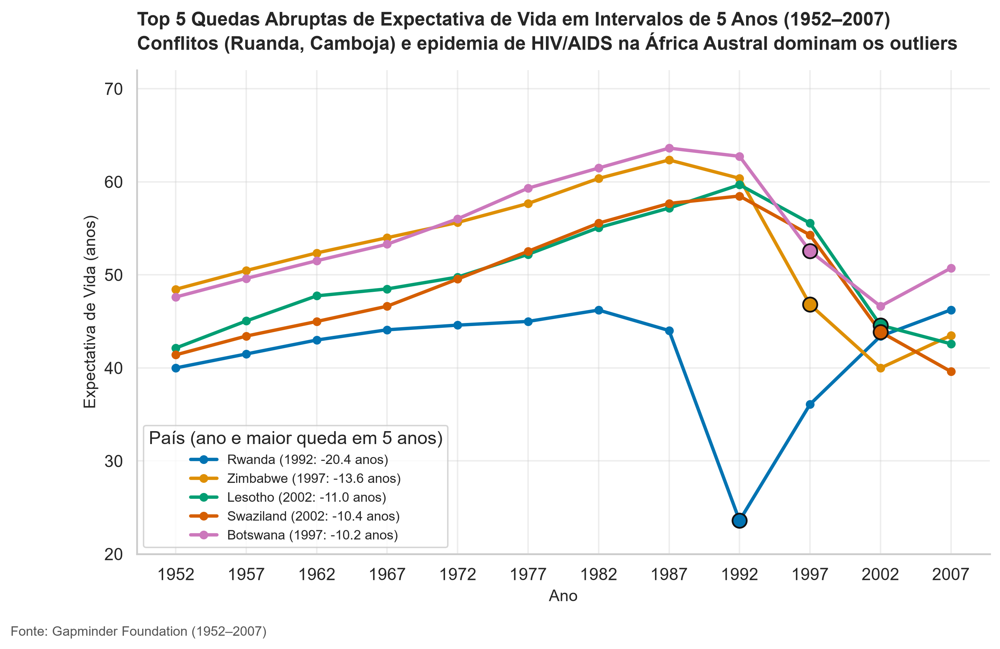

# Análise Exploratória de Dados — Gapminder (1952–2007)

Projeto de análise de dados com gráficos utilizando **Python, pandas, Matplotlib e Seaborn** sobre o dataset público **Gapminder** (142 países, 5 continentes, recortes quinquenais de 1952 a 2007, 1.704 observações).

A arquitetura combina código modular e testado em [`src/`](src/), narrativa interativa em [`notebooks/01_eda_gapminder.ipynb`](notebooks/01_eda_gapminder.ipynb) e visualizações exportadas em 300 DPI em [`outputs/figures/`](outputs/figures/), seguindo o planejamento definido no [`PRD.md`](PRD.md).

---

## Principais Números em Destaque

| Indicador | Resultado |
| :--- | :--- |
| **Expectativa de vida global (ponderada por população)** | **48,94 anos (1952) → 68,92 anos (2007)** (`+19,97 anos`) |
| **Correlação PIB per capita × Expectativa de vida (2007)** | Pearson linear: **0,6787** · Pearson `log10(PIB)`: **0,8090** · Spearman: **0,8566** |
| **Maior ganho absoluto de expectativa de vida (1952–2007)** | **Omã (`+38,06 anos`)**, de 37,58 para 75,64 anos |
| **Maior queda quinquenal registrada** | **Ruanda em 1992 (`-20,42 anos`)**, caindo para 23,60 anos |
| **Qualidade dos dados** | 1.704 registros, 0 duplicatas `(country, year)`, 0 nulos nas colunas centrais |

---

## Perguntas Respondidas e Visualizações

### 1. Como evoluiu a expectativa de vida global e por continente (1952–2007)?

A média global ponderada pela população avançou quase **20 anos** em 55 anos (+19,97 anos). A **Ásia** (+24,42 anos na média simples, de 46,31 para 70,73) e as **Américas** (+20,33 anos, de 53,28 para 73,61) aproximaram-se fortemente da **Europa** (77,65) e da **Oceania** (80,72). A **África**, após crescer de 39,14 (1952) até o fim dos anos 1980, enfrentou estagnação na década de 1990, fechando 2007 em 54,81 anos.



---

### 2. Qual é a relação entre PIB per capita e expectativa de vida?

A relação é fortemente positiva, porém **não-linear**: em 2007, a correlação de Pearson em escala linear é `0,6787`, mas sobe para **`0,8090`** ao aplicar escala logarítmica (`log10`) no PIB per capita e atinge **`0,8566`** na correlação monotônica de Spearman. Isso demonstra retornos decrescentes de renda sobre a longevidade: aumentos iniciais de renda em países mais pobres geram saltos expressivos em saúde básica, enquanto acima de US$ 15.000 per capita a curva se achata.



---

### 3. Como mudou a desigualdade intra-continental entre 1952 e 2007?

| Continente | Países | Média 1952 | Média 2007 | Desvio-Padrão 1952 | Desvio-Padrão 2007 | PIB per Capita Mediano 2007 (USD) |
| :--- | :---: | :---: | :---: | :---: | :---: | :---: |
| **África** | 52 | 39,14 | 54,81 | 5,15 | **9,63** | 1.452,27 |
| **Américas** | 25 | 53,28 | 73,61 | 9,33 | **4,44** | 8.948,10 |
| **Ásia** | 33 | 46,31 | 70,73 | 9,29 | **7,96** | 4.471,06 |
| **Europa** | 30 | 64,41 | 77,65 | 6,36 | **2,98** | 28.054,07 |
| **Oceania** | 2 | 69,26 | 80,72 | 0,19 | **0,73** | 29.810,19 |

Enquanto **Europa** (desvio-padrão caiu de 6,36 para 2,98) e **Américas** (de 9,33 para 4,44) convergiram internamente, a **África** quase dobrou sua dispersão (de 5,15 para 9,63), refletindo o descolamento entre países do Norte da África (acima de 70 anos) e países da África Subsaariana (abaixo de 50 anos).



---

### 4. Quais países tiveram o maior ganho absoluto em expectativa de vida?

O topo do ranking é dominado por países da **Ásia** e do **Norte da África** que passaram por rápida urbanização, ampliação de infraestrutura sanitária e queda na mortalidade infantil:
1. **Omã (Ásia):** 37,58 → 75,64 (`+38,06 anos`)
2. **Vietnã (Ásia):** 40,41 → 74,25 (`+33,84 anos`)
3. **Indonésia (Ásia):** 37,47 → 70,65 (`+33,18 anos`)
4. **Arábia Saudita (Ásia):** 39,88 → 72,78 (`+32,90 anos`)
5. **Líbia (África):** 42,72 → 73,95 (`+31,23 anos`)



---

### 5. Quais anomalias e quedas históricas aparecem na série?

As quedas mais agudas em intervalos de 5 anos expõem choques históricos graves:
- **Ruanda (1992):** `-20,42 anos` (expectativa caiu para 23,60 anos, refletindo conflitos e o genocídio de 1994 capturado na série interpolada do Gapminder).
- **Zimbábue (1997):** `-13,57 anos`, **Lesoto (2002):** `-10,96 anos`, **Suazilândia (2002):** `-10,42 anos` e **Botsuana (1997):** `-10,19 anos` — impacto severo da epidemia de HIV/AIDS na África Austral antes da disseminação ampla de antirretrovirais.



---

## Limitações Metodológicas e Próximos Passos

- **Recorte temporal:** a versão clássica do Gapminder encerra em **2007** e utiliza intervalos de **5 em 5 anos**, podendo suavizar ou deslocar levemente picos de eventos anuais agudos.
- **Granularidade nacional:** indicadores agregados por país não capturam desigualdades internas (regionais, urbanas vs. rurais ou de gênero).
- **Correlação ≠ Causalidade:** a associação forte entre PIB per capita e expectativa de vida não implica causalidade unilateral — saúde pública, educação e estabilidade institucional operam em mão dupla com o crescimento econômico.
- **Próximos passos possíveis:** atualizar a série com dados pós-2007 do Banco Mundial/OMS (incluindo impacto da pandemia de COVID-19) e adicionar indicadores de mortalidade infantil e escolaridade.

---

## Como Reproduzir

```powershell
# 1. Criar e ativar o ambiente virtual (opcional, recomendado)
python -m venv .venv
.\.venv\Scripts\Activate.ps1

# 2. Instalar dependências
pip install -r requirements.txt

# 3. Executar o pipeline completo (ingestão -> limpeza -> estatísticas -> gráficos)
python -m src.main

# 4. Abrir o notebook interativo
jupyter notebook notebooks/01_eda_gapminder.ipynb

# 5. Executar testes automatizados e linter
pytest -v
ruff check src tests
```

---

## Estrutura do Projeto

```text
data-analysis/
├── PRD.md                           # Especificação, requisitos e etapas com política de commits
├── README.md                        # Conclusões documentadas, gráficos e guia de reprodução
├── requirements.txt                 # Dependências do projeto
├── pyproject.toml                   # Configuração do pytest e ruff
├── data/
│   ├── raw/gapminder.tsv            # Dataset bruto imutável (Gapminder, CC-BY 4.0)
│   └── processed/gapminder_clean.csv# Dataset limpo e enriquecido
├── src/
│   ├── data_loader.py               # Download reproduzível e validação de schema
│   ├── data_cleaning.py             # Limpeza, métricas derivadas e relatório de qualidade
│   ├── analysis.py                  # Estatísticas por continente, correlações, rankings e outliers
│   ├── visualizations.py            # 5 gráficos padronizados (Matplotlib + Seaborn, 300 DPI)
│   └── main.py                      # Orquestrador CLI de ponta a ponta
├── notebooks/
│   └── 01_eda_gapminder.ipynb       # Exploração narrativa executada e validada
├── outputs/
│   └── figures/                     # 5 gráficos PNG (300 DPI)
└── tests/                           # 21 testes unitários cobrindo ingestão, limpeza, análise e gráficos
```
